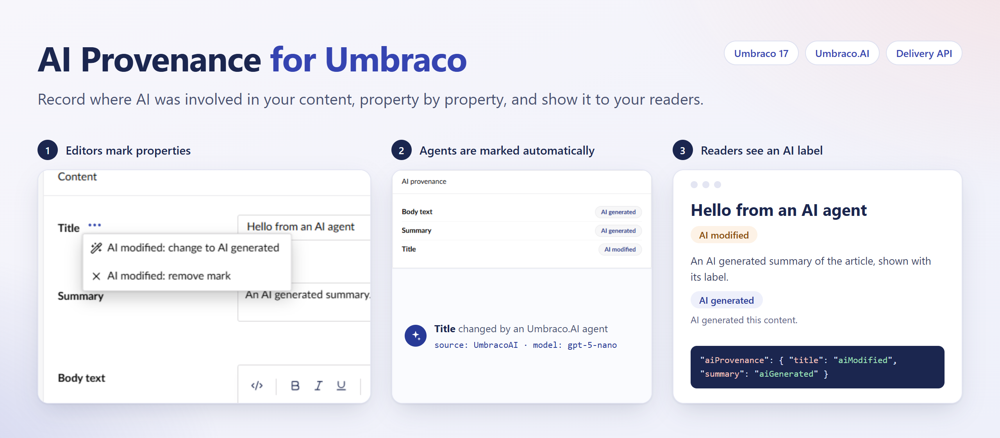
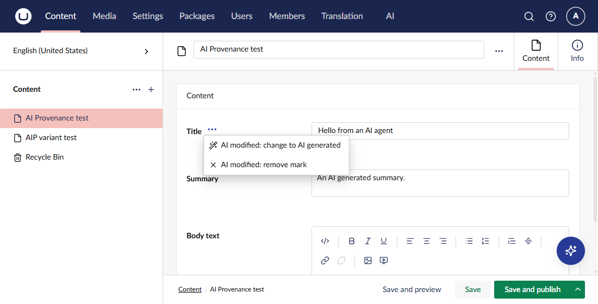
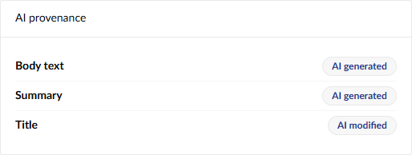
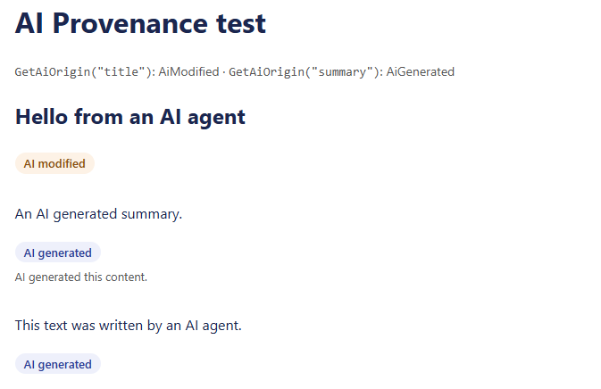

# AI Provenance for Umbraco

[](https://www.nuget.org/packages/Umbraco.Community.AIProvenance/)
[](https://www.nuget.org/packages/Umbraco.Community.AIProvenance)
[](../LICENSE)

AI Provenance records where AI was involved in your Umbraco content, one property at a time. Editors mark properties as **AI generated** or **AI modified**. With Umbraco.AI, agents' changes are marked automatically. Your website and the Content Delivery API can then show an AI label next to marked content.



## What it does

- Editors mark any property as AI generated or AI modified, change the mark, or remove it. This works per culture and for properties inside blocks.
- Editors see the marks in each property's action menu and in the document's Info view.
- Publishing copies the marks to the published content, so the website shows them when it shows the content.
- Razor views read the marks with `GetAiOrigin()`, and the `<ai-label>` tag helper renders an accessible label.
- The Content Delivery API includes the marks in each content item.
- An optional add-on marks properties automatically when an Umbraco.AI agent changes them, and records the AI provider and model.

## What it does not do

- **It does not detect AI.** It records what editors mark and what Umbraco.AI agents write. Text pasted in from another AI tool stays unmarked until an editor marks it. An unmarked property does not prove that a person wrote it.
- **It does not make your site compliant** with the EU AI Act or any other law. It gives you information that can help with compliance.
- **It does not watermark content.** It does not add C2PA Content Credentials or other machine-readable marks to the content itself.
- **It does not cover media.** For images, use [AI Image Disclosure](https://github.com/thebuilder/umbraco-ai-image-disclosure).

## Packages

| Package | Install it when | Needs |
|---|---|---|
| `Umbraco.Community.AIProvenance` | Always | Umbraco 17.8.1 or later |
| `Umbraco.Community.AIProvenance.UmbracoAI` | You use Umbraco.AI agents and want their changes marked automatically | Umbraco.AI 17.8 or later, which it installs |

```sh
dotnet add package Umbraco.Community.AIProvenance
dotnet add package Umbraco.Community.AIProvenance.UmbracoAI
```

Restart the site after you install. The package creates its database table on startup.

## Mark content in the backoffice

Open a property's action menu (the **…** next to its label) and choose **Mark as AI generated** or **Mark as AI modified**. The menu then shows the property's mark, and lets you change it or remove it.



The document's **Info** view lists every marked property.



The actions appear on text, rich text, Markdown, tags, code, block, media, upload and link properties.

## Show AI labels on your website



Register the tag helper in `Views/_ViewImports.cshtml`:

```cshtml
@addTagHelper *, Umbraco.Community.AIProvenance
```

Then wrap a property's output in `<ai-label>`:

```cshtml
<ai-label for="summary" position="after">
    <p>@Model.Value("summary")</p>
</ai-label>
```

- When the property has a mark, the tag helper renders a label before the content, or after it with `position="after"`.
- When the property has no mark, it renders only the content.
- For a property inside a block, pass the block's content with `item="@block.Content"`.

The label is a `<details>` element. The explanation opens on click, tap or keyboard, with no JavaScript, and screen readers announce it. The package adds no styles, so style the label to suit your site. These are the classes:

| Class | Element |
|---|---|
| `ai-label` | The label |
| `ai-label--generated`, `ai-label--modified` | The label, by origin |
| `ai-label__text` | The short text, such as "AI generated" |
| `ai-label__description` | The explanation |

The test site's template has [example styles](../src/Umbraco.Community.AIProvenance.TestSite/Views/aipTestPage.cshtml).

### Change the text

Create dictionary items with these keys. Empty or missing items use the English default.

| Key | Default |
|---|---|
| `AIProvenance.AiGenerated` | AI generated |
| `AIProvenance.AiGeneratedDescription` | AI generated this content. |
| `AIProvenance.AiModified` | AI modified |
| `AIProvenance.AiModifiedDescription` | Our editors wrote this content and edited it with AI. |

### Change the markup

Create your own `Views/Partials/AIProvenance/Label.cshtml`. It replaces the package's view. Its model is `Umbraco.Community.AIProvenance.Rendering.AiLabelViewModel`, with the `Origin`, `Text`, `Description` and `PropertyAlias`.

The European Commission offers [optional icons for AI-generated and AI-modified content](https://digital-strategy.ec.europa.eu/en/policies/eu-icons-labelling-ai-generated-content). The package does not include them, because their licence is unclear. You can download them and use them in your own label view.

## Read marks in Razor

```cshtml
@if (Model.GetAiOrigin("summary") == AiOrigin.AiGenerated)
{
    ...
}
```

`GetAiOrigin` returns `AiOrigin.AiGenerated`, `AiOrigin.AiModified` or `AiOrigin.None`, for the current culture. Pass a culture to read another one. For a property inside a block, call `block.Content.GetAiOrigin(Model, "alias")`. Add `@using Umbraco.Community.AIProvenance.Models` to use `AiOrigin`.

The website reads the published marks. Preview reads the draft marks.

## Content Delivery API

Each content item gets an `aiProvenance` entry in its `properties`, with the marked properties in the request's culture:

```json
"properties": {
  "title": "Hello from an AI agent",
  "summary": "An AI generated summary.",
  "aiProvenance": {
    "title": "aiModified",
    "summary": "aiGenerated"
  }
}
```

The entry is inside `properties`, because the Delivery API does not accept extra fields beside them. Umbraco's extended webhooks include it too. Properties inside blocks are not included.

## Automatic marking with Umbraco.AI

With `Umbraco.Community.AIProvenance.UmbracoAI` installed, the package marks each property that an Umbraco.AI agent changes:

- A value that was empty becomes **AI generated**.
- A value that had content becomes **AI modified**.
- An AI generated mark never changes to AI modified automatically.

The mark records the AI provider and model. It works for agents in the Copilot chat and for Automate workflows that are allowed to change content.

When an editor applies a prompt suggestion, Umbraco.AI changes the value in the browser and raises no event. The package cannot detect this, so editors mark these properties themselves. See [Proposed Umbraco.AI extension points](../docs/discovery.md#proposed-umbracoai-extension-points).

## Notifications

The package publishes two Umbraco notifications, so your code can react to marks, for example to log changes for an audit or alert a reviewer:

| Notification | When | Contains |
|---|---|---|
| `AiProvenanceMarkSavedNotification` | A draft mark is set or changed, by an editor or by the Umbraco.AI add-on | `Mark` (the property, origin, source, provider, model and user) and `PreviousOrigin` |
| `AiProvenanceMarkRemovedNotification` | A draft mark is removed | `Mark`, the removed mark |

Register a handler in a composer, as for any Umbraco notification:

```csharp
builder.AddNotificationAsyncHandler<AiProvenanceMarkSavedNotification, MyMarkHandler>();
```

They are published when the database transaction completes, so a handler never sees a change that was rolled back. Publishing, unpublishing, copying and deleting documents do not publish them, because Umbraco already raises notifications for those operations.

## Configuration

```json
{
  "AIProvenance": {
    "DeliveryApiEnabled": true,
    "UmbracoAI": {
      "AutomaticMarking": true
    }
  }
}
```

| Setting | Default | Effect |
|---|---|---|
| `AIProvenance:DeliveryApiEnabled` | `true` | Adds the `aiProvenance` entry to Delivery API output |
| `AIProvenance:UmbracoAI:AutomaticMarking` | `true` | Marks properties that Umbraco.AI agents change (add-on only) |

## Known limitations

- **Rollback** does not restore marks. After a rollback, the draft keeps its current marks, and editors adjust them.
- **Editor-applied prompt suggestions** are not marked automatically (see above).
- **Copying a document** copies its marks, except marks on properties inside blocks, because Umbraco gives copied blocks new keys.
- **Automatic marking inside blocks** marks the block property as a whole.
- **Third-party property editors** do not show the mark actions. The package lists Umbraco's own content editors.
- **Media** is not covered.

## How it works

The package stores marks in its own database table, so it works with every document type, with no schema changes. [docs/design.md](../docs/design.md) explains the design and the reasons for it. [docs/discovery.md](../docs/discovery.md) records how Umbraco and Umbraco.AI work, with links to their source.

## Contributing

Contributions are welcome. Read the [contributing guidelines](CONTRIBUTING.md) and [docs/development.md](../docs/development.md).

## Acknowledgements

- The package follows the model of the AI content marking in Xperience by Kentico.
- The repository started from Lotte Pitcher's [Opinionated Package Starter](https://github.com/LottePitcher/opinionated-package-starter).
