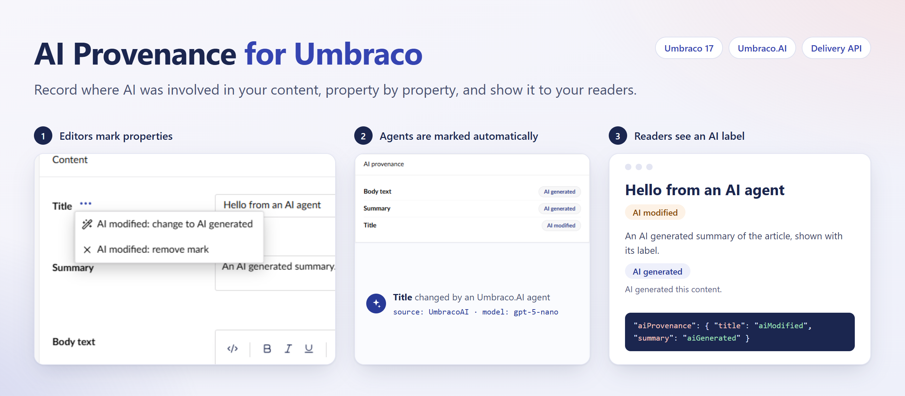

# AI Provenance for Umbraco

Records where AI was involved in your Umbraco content, one property at a time.

- Editors mark any property as **AI generated** or **AI modified** from its action menu, per culture and inside blocks. The document's Info view lists the marks.
- Publishing copies the marks to the published content.
- Razor views read the marks with `GetAiOrigin()`, and the `<ai-label>` tag helper renders an accessible label.
- Headless sites read the marks from the Content Delivery API.

To mark Umbraco.AI agents' changes automatically, also install [`Umbraco.Community.AIProvenance.UmbracoAI`](https://www.nuget.org/packages/Umbraco.Community.AIProvenance.UmbracoAI).

The package does not detect AI, and it does not make a site compliant with the EU AI Act. It records what editors mark and what Umbraco.AI agents write.

Requires Umbraco 17.8.1 or later.

Read the [full documentation on GitHub](https://github.com/liamgold/umbraco-ai-provenance#readme).
