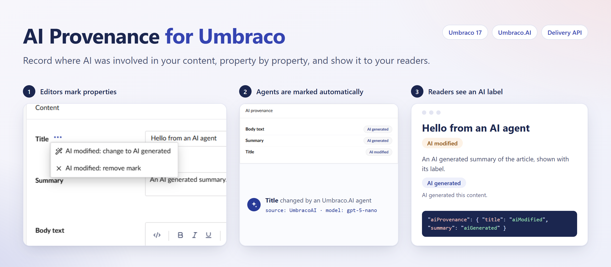

# AI Provenance for Umbraco.AI

An add-on for [`Umbraco.Community.AIProvenance`](https://www.nuget.org/packages/Umbraco.Community.AIProvenance). When an Umbraco.AI agent changes content, it marks each changed property:

- A value that was empty becomes **AI generated**.
- A value that had content becomes **AI modified**.
- An AI generated mark never changes to AI modified automatically.

Each mark records the AI provider and model.

It works for agents in the Copilot chat, and for Automate workflows that are allowed to change content. Prompt suggestions that an editor applies in the browser are not marked automatically, because Umbraco.AI raises no event for them.

Requires Umbraco 17.8.1 or later and Umbraco.AI 17.8 or later.

Read the [full documentation on GitHub](https://github.com/liamgold/umbraco-ai-provenance#readme).
